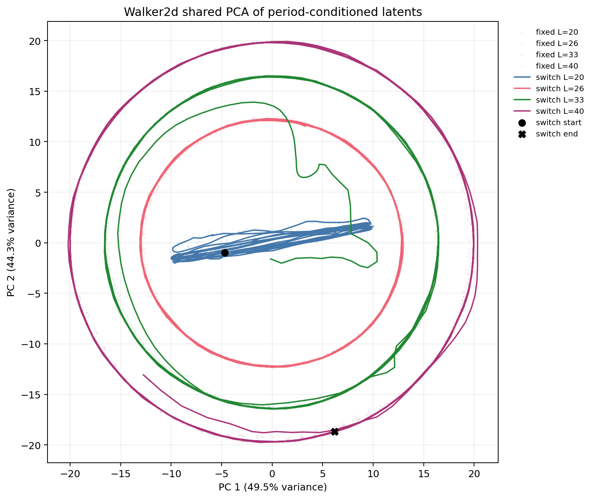

# Periodic Skill Discovery — independent replication

An independent PyTorch reconstruction of **Periodic Skill Discovery (PSD)**, targeting state-based MuJoCo experiments in HalfCheetah, Ant and Walker2D. Reference: [Park et al., paper and demonstrations](https://jonghaepark.github.io/psd/) · [paper](https://arxiv.org/abs/2511.03187).

**Status:** training and evaluation runs are complete. Forward locomotion and useful latent geometry were learned, but the physical gait results are mixed. This repository documents that outcome and the methodological gaps; it does not claim an exact reproduction of the authors' results. The initial toy ring check is [archived separately](archive/ring_pilot/README.md).

## Results at a glance

Each row is **one training seed**. Five fresh reset seeds per L were used for the gait evaluations; those are not five independent training runs.

| Experiment | Training | Main observation |
|---|---|---|
| HalfCheetah, adaptive L | 320,000 episodes, PSD + forward reward | Completed Figure 9 comparison. Final lower / plotted upper bounds 8 / 21 versus approximately 5 / 16 in the digitized reference. |
| Ant, fixed L=20 | 80,000 episodes, PSD only | Latent diameter near 20; physical cycles roughly 45–48 steps versus requested 40. |
| Walker2D, L=20,26,33,40 | 80,000 episodes, PSD only | Gait matches 0/5, 2/5, 2/5, 4/5 by L. Continuous switching rollout fell at step 431 of 1,600. |
| Walker2D, same four L values | 80,000 episodes, PSD + forward reward | Mean evaluation speed 1.25 m/s; completed all 1,600 switching steps. Original recurrence test: 0/5 at every L. |
| Ant, L=10,13,16,20 | 80,000 episodes, PSD + forward reward | Mean evaluation speed 1.51 m/s; completed all 800 switching steps. Original recurrence test: 0/5 at every L. |

Our physical-gait diagnostic uses a normalized joint-angle/rate return error cutoff of 0.35 and a ±10% target-period tolerance. **Those are our diagnostic choices, not acceptance criteria stated by the paper.** A separate exploratory analysis finds near-target late Walker2D rhythms, but does not establish reliable full-episode gaits. [Methods and limitations](docs/METHODS_AND_LIMITATIONS.md) explain the distinction.

[Browse all curated results and provenance](reports/README.md).

### One continuous L-switching rollout

Below is the combined-reward Walker2D rollout: one episode, switching L at steps 400, 800 and 1,200, with no resets. Colored lines show that trajectory; faint points are fixed-L reference rollouts in the same PCA coordinates. The encoder is conditioned on L, so changing L can change the encoded position even without a physical reset. Circles in latent space do not alone prove physical gait periodicity.



## What is implemented

- PSD's encoder objective (Equation 7), intrinsic reward (Equation 8), and 8D sinusoidal L conditioning.
- Continuous-action SAC with two 1,024-unit hidden layers, twin critics, target critics and automatic entropy tuning.
- HalfCheetah adaptive period sampling; fixed four-period training for Ant and Walker2D.
- Optional combined reward: `r_PSD + min(v_x / v_target, 1)`. Targets are 0.5 m/s for Ant and 1.0 m/s for Walker2D; backward velocity remains negative.
- Checkpoint/resume with model, optimizers, replay, configuration and RNG state; termination-aware rollouts, joint traces, recurrence diagnostics and PCA.
- Durable L40S Slurm launchers with explicit commands and `DRY_RUN=1`.

Gymnasium supplies the environment interface; **MuJoCo supplies the physics**. The recorded Oscar stack was Python 3.11, Gymnasium 1.2.1, MuJoCo 4.0.1, NumPy 2.2.6, Matplotlib 3.10.7 and PyTorch 2.7.1+cu118. Local CUDA smoke runs used a different CUDA wheel. These runs do not establish equivalence with the authors' unspecified simulator version.

## Install

Use Python 3.11. From the repository root:

```bash
python -m venv .venv
```

Activate with `source .venv/bin/activate` on Linux/macOS or `.\.venv\Scripts\Activate.ps1` in Windows PowerShell. For CPU execution:

```bash
python -m pip install torch==2.7.1 --index-url https://download.pytorch.org/whl/cpu
python -m pip install -r requirements.txt
```

For an Oscar-style CUDA installation, replace the first install command with:

```bash
python -m pip install torch==2.7.1+cu118 --index-url https://download.pytorch.org/whl/cu118
```

Use a compatible PyTorch wheel for your GPU/driver. Choose `--device cpu` or `--device cuda` explicitly in commands below.

## Quick execution check

This two-epoch example checks execution; it does not demonstrate a learned gait:

```bash
python -B mujoco_psd/train_walker2d.py --epochs 2 --seed 0 --device cpu --reward-mode intrinsic_velocity --out mujoco_psd/runs/walker_smoke
python -B mujoco_psd/evaluate_walker2d.py mujoco_psd/runs/walker_smoke/checkpoint.pt --device cpu --out mujoco_psd/runs/walker_smoke/evaluation
```

Use an unused output directory. To continue the same configuration, add `--resume` and increase the **total** epoch limit. Changing reward mode requires a fresh run; the code rejects incompatible checkpoint configurations.

## Reproduce the recorded training conditions

Each epoch collects eight episodes. The Ant and Walker2D commands below request 10,000 epochs / 80,000 episodes; HalfCheetah requests 40,000 epochs / 320,000 episodes. Early falls can reduce transition counts. These are substantial GPU runs, not quick tests.

```bash
python -B mujoco_psd/train_ant.py --epochs 10000 --periods 10,13,16,20 --reward-mode intrinsic_velocity --seed 0 --device cuda --out mujoco_psd/runs/ant_combined
python -B mujoco_psd/train_walker2d.py --epochs 10000 --periods 20,26,33,40 --reward-mode intrinsic_velocity --seed 0 --device cuda --out mujoco_psd/runs/walker_combined
python -B mujoco_psd/train.py --epochs 40000 --seed 0 --device cuda --midpoint-episodes 160000 --compare-figure9 --out mujoco_psd/runs/halfcheetah_adaptive
```

Use `--reward-mode intrinsic_only` for the Ant/Walker PSD-only conditions. To reproduce the fixed L=20 Ant condition, use `--periods 20` with `train_ant.py` and evaluate with `evaluate_ant.py`.

Evaluate the multi-period checkpoints:

```bash
python -B mujoco_psd/evaluate_ant_figure5.py mujoco_psd/runs/ant_combined/checkpoint.pt --device cuda --out mujoco_psd/runs/ant_combined/evaluation
python -B mujoco_psd/evaluate_walker2d.py mujoco_psd/runs/walker_combined/checkpoint.pt --device cuda --out mujoco_psd/runs/walker_combined/evaluation
```

The saved PNG, JSON and NPZ reports describe episode completion, speeds, joint states and latent trajectories. Native Gymnasium environment returns in evaluation are distinct from the combined training objective.

## Inspect the published results without training

Curated JSON, plots and raw evaluation NPZ files are included in `reports/`. Checkpoints and full replay buffers are not included. Regenerate the exploratory gait-gap analysis directly from the published raw trajectories:

```bash
python -B mujoco_psd/analyze_combined_gait_gap.py --runs-root reports --out mujoco_psd/runs/published_gait_gap
```

This leaves the versioned evidence unchanged. [Results index](reports/README.md) · [methods and interpretation](docs/METHODS_AND_LIMITATIONS.md).

## Oscar / Slurm

Stage this repository and its Python environment on Oscar. Submit from the staged repository root; launchers default to `.oscar-venv/bin/python` and accept `PYTHON_BIN` overrides. For the combined conditions:

```bash
export ROBOT=walker2d SEED=0 EPOCHS=10000
bash -n mujoco_psd/combined_forward_figure5_l40s.sbatch
DRY_RUN=1 bash mujoco_psd/combined_forward_figure5_l40s.sbatch
sbatch --test-only mujoco_psd/combined_forward_figure5_l40s.sbatch
sbatch mujoco_psd/combined_forward_figure5_l40s.sbatch
```

Set `ROBOT=ant` for Ant. Each job requests one L40S, four CPU cores, 12 GB RAM and eight hours, and evaluates after training. Recorded full runs took about 3–3.3 hours each, excluding queue time. For pilot/resume examples and recorded job provenance, see [combined runs](docs/experiments/COMBINED_FORWARD_OSCAR.md), [Walker2D intrinsic](docs/experiments/WALKER2D_OSCAR.md), and [Ant L=20](docs/experiments/ANT_L20_OSCAR.md).

## Layout and handoff

```text
mujoco_psd/          Active training, evaluation, analysis and sbatch scripts
reports/             Curated published results and raw evaluation trajectories
docs/                Methods, limitations and experiment notes
archive/ring_pilot/   Historical toy method check
AGENTS.md            Canonical agent/development instructions
agent.md             Short researcher/agent handoff
requirements.txt     Pinned Python dependencies
```

Local environments, caches, checkpoints and new `mujoco_psd/runs/` outputs are ignored. Previous local runs are preserved in ignored `local_artifacts/`; fresh clones rely on `reports/` instead.

The most important unresolved fidelity gaps are **no adaptive curriculum in Ant/Walker2D**, an 80k budget versus Figure 9's roughly 320k episodes, environment-version uncertainty and one training seed per condition. The authors' exact Figure 5 checkpoint age is not specified. See [the full limitations](docs/METHODS_AND_LIMITATIONS.md) before treating these results as confirmation or contradiction of the paper.
